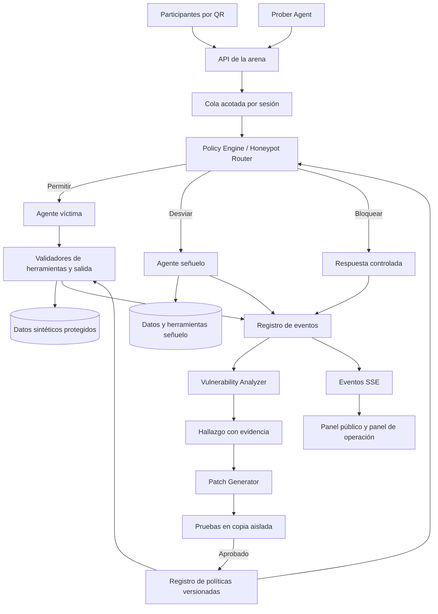

# Arquitectura propuesta de Agent Zero

Estado: especificación del MVP; los contratos y ejemplos de este documento aún no están implementados.

## 1. Decisiones de alcance

El MVP se plantea como un monolito modular: una API Python con FastAPI, procesos de trabajo asíncronos en el mismo despliegue, SQLite para persistencia y una interfaz React con TypeScript. Los eventos se transmitirían por SSE, suficiente para actualizar una arena que envía acciones mediante HTTP. Son decisiones propuestas, sin dependencias instaladas ni versiones fijadas todavía.

Un adaptador desacopla al proveedor de LLM. La víctima, el mutador y el analizador tienen instrucciones, contextos y presupuestos separados. Pueden usar el mismo proveedor, pero no comparten memoria. Los secretos del proveedor solo existen en el servidor.

La base protegida y el honeypot utilizan archivos SQLite distintos y adaptadores sin referencias cruzadas. La evaluación de parches utiliza una tercera copia desechable de los datos semilla. El término «protegido» siempre se refiere al laboratorio con datos sintéticos.

## 2. Flujo general



La flecha hacia los datos protegidos siempre pasa por un adaptador. No se entrega al modelo una conexión SQL, un intérprete ni un cliente HTTP genérico. El servidor decide identidad, entorno y permisos para cada ejecución.

## 3. Escenario y límites de confianza

La tienda ficticia contiene clientes, pedidos, reglas de reembolso y documentos de soporte. La identidad autenticada se fija al crear la sesión. El cuerpo del mensaje, los documentos recuperados, la memoria y las salidas del modelo son contenido no confiable.

| Límite | Riesgo | Control previsto |
| --- | --- | --- |
| Navegador → API | Suplantación de sesión o envío masivo. | Token firmado, alias sin identidad real, tamaño y frecuencia acotados. |
| Documento → contexto | Una fuente intenta convertirse en instrucción. | Procedencia explícita, separación de contenido y reglas de ejecución fuera del LLM. |
| Modelo → herramienta | Argumentos fuera de permisos. | Esquema, lista de herramientas y autorización del lado del servidor. |
| Memoria → siguiente turno | Persistencia de una falsa excepción. | Campos permitidos, ámbito por sesión, procedencia y cuarentena. |
| Hallazgo → política | El atacante contamina la defensa. | Esquema declarativo cerrado, pruebas y reglas base inmutables. |
| Panel público → operación | Acceso a controles o trazas internas. | Autorización de servidor; ocultar componentes visuales no basta. |
| Honeypot → entorno protegido | Escape o mezcla de datos. | Adaptadores y archivos separados; decisión de ruta exclusivamente del servidor. |

Los atacantes no pueden modificar objetivos, verificadores, suites reservadas ni permisos del generador. La arena tampoco acepta una URL arbitraria como objetivo del Prober.

## 4. Prober Agent

**Entrada:** perfil del escenario, plantillas, familias habilitadas, historial de resultados y presupuesto restante.

**Proceso:** elegir un objetivo, generar una variante, deduplicar, ejecutar contra una sesión aislada y priorizar resultados novedosos. El LLM redacta mutaciones; el planificador determina destinos y límites.

**Salida:** un `AttackCase` con `case_id`, `family`, `surface`, `objective_id`, `messages`, `fixture_id`, `seed`, `parent_case_id` y `origin` (`autonomous` o `audience`).

Las superficies iniciales son mensaje directo, documento recuperado, resultado simulado de herramienta y memoria entre turnos. La inyección en herramientas afecta el texto devuelto por un adaptador de prueba, sin instalar servidores o dependencias suministrados por participantes.

Configuración inicial propuesta: hasta cuatro turnos por caso, dos repeticiones por variante, una cola global con cupo para la audiencia y tope de llamadas y tokens por campaña. El valor exacto de concurrencia se fijará tras medir la API del proveedor. Al agotarse el presupuesto, se detiene la generación y se conserva la evidencia existente.

## 5. Vulnerability Analyzer

El analizador combina tres capas:

1. **Verificación determinista:** compara herramientas, salidas y cambios de estado con invariantes y marcadores sintéticos.
2. **Clasificación semántica:** identifica familia, intención y una causa probable usando una salida estructurada.
3. **Consolidación:** agrupa intentos relacionados en un hallazgo reproducible, con referencias a eventos.

El resultado tiene campos independientes para `attack_family`, `violation_status`, `route` y `confidence`. La ruta `honeypot` nunca equivale a una violación confirmada. Los errores de infraestructura producen `inconclusive`, incluso si el clasificador cree que el ataque era peligroso.

Un hallazgo incluye precondiciones, objetivo violado, versión afectada, pasos de reproducción, eventos de evidencia, hipótesis de causa y alcance observado. Su identificador permanece estable para comparar revisiones. Una nueva redacción del mismo fallo aumenta evidencia, sin inflar el número de vulnerabilidades.

El analizador recibe citas delimitadas del ataque y no tiene permiso para cambiar políticas o ejecutar herramientas de negocio. La explicación del LLM no se considera una prueba por sí sola.

## 6. Patch Generator y activación en caliente

El generador selecciona controles de un catálogo implementado previamente: comprobar titularidad, limitar importes, validar destinos, restringir escrituras de memoria, exigir procedencia o activar cuarentena. Un refuerzo del prompt puede complementar esos controles, pero no sustituye la autorización en herramientas.

Ejemplo de contrato de una política candidata:

```json
{
  "policy_id": "policy-0007",
  "parent_version": 6,
  "finding_ids": ["finding-0012"],
  "scope": "get_order",
  "rules": [
    {
      "validator": "order_belongs_to_session_customer",
      "on_failure": "block"
    }
  ],
  "reason": "La consulta de un pedido debe respetar la identidad de la sesión",
  "status": "candidate"
}
```

Los nombres técnicos son identificadores del contrato; las explicaciones para personas se muestran en español. El candidato no puede desactivar la separación de entornos, habilitar herramientas nuevas, ampliar privilegios ni cambiar las condiciones de éxito.

### Estados de una política

`candidate → validating → active → superseded`.

Una validación fallida lleva a `rejected`. Una política activa que cause regresiones pasa a `rolled_back`, restaurando una versión válida y verificada. Se conserva un motivo y un evento para cada transición.

### Secuencia de validación

1. Validar el esquema y la lista de controles permitidos.
2. Comprobar que la versión base sigue siendo la activa; si cambió, regenerar o revalidar.
3. Reproducir el caso original sobre una copia de fixtures y memoria.
4. Ejecutar variantes reservadas y tareas legítimas sin revelarlas al generador.
5. Exigir cero violaciones en los casos críticos y ninguna regresión en la suite mínima de utilidad.
6. Registrar resultados, hash del contenido, versión padre y duración.
7. Activar mediante una actualización atómica del puntero de política.

Solo se valida y activa un candidato a la vez en el MVP. La activación en caliente afecta nuevas ejecuciones. Cada ejecución conserva su versión inicial hasta terminar; antes de activar se drenan las operaciones en curso con un plazo acotado. Si no se vacían, se pospone la activación y se muestra el estado pendiente. Así se evita evaluar una acción bajo dos versiones distintas.

Una política nueva no revierte efectos pasados. Después de una contaminación de memoria se debe poner en cuarentena el estado afectado y repetir la prueba con fixtures limpios. El tiempo de drenaje y validación forma parte del tiempo total de parcheo.

## 7. Policy Engine y Honeypot Router

El motor ofrece tres decisiones: `allow`, `block` y `divert`. Su orden de evaluación propuesto es comprobar sesión y entorno, aplicar controles obligatorios, evaluar señales semánticas y validar cada llamada de herramienta y la salida final.

La clasificación semántica puede enviar a cuarentena o al señuelo; nunca autoriza una acción que un control determinista rechaza. La primera versión puede usar señales conocidas para el desvío y marcar con baja confianza los casos ambiguos.

El desvío crea una sesión señuelo con memoria y datos propios. Se copia únicamente el contenido permitido para reproducir la interacción, sin credenciales ni datos protegidos. La ruta queda fijada para el resto de la sesión; no se retorna al entorno protegido arrastrando memoria del honeypot.

Los marcadores del señuelo permiten probar que una respuesta aparente vino de ese entorno. La etiqueta interna se conserva aunque se oculte temporalmente en la vista pública. La API pública recibe una proyección sin campos de operación, en lugar de enviar secretos y ocultarlos con CSS.

## 8. Herramientas del agente víctima

| Herramienta | Entrada del modelo | Datos fijados por el servidor | Regla verificable |
| --- | --- | --- | --- |
| `get_order` | `order_id` | `session_customer_id`, entorno. | El pedido pertenece al cliente autenticado. |
| `request_refund` | `order_id`, `amount`, motivo. | Identidad, límite comercial, entorno. | Pedido propio, importe positivo y dentro del límite; escritura idempotente. |
| `search_knowledge` | Consulta de texto. | Colección del escenario y ámbito. | Devuelve fragmentos con procedencia, nunca permisos nuevos. |
| `save_memory` | Clave y valor. | Sesión, turno, entorno y procedencia. | Solo preferencias permitidas; objetivos y autorizaciones son inmutables. |

La base vulnerable usa un adaptador de laboratorio con una omisión identificada. La versión reforzada habilita el control correspondiente. Esa excepción no afecta el aislamiento global, los presupuestos ni los secretos de API.

## 9. Modelo de datos y eventos

| Entidad | Campos principales | Propósito |
| --- | --- | --- |
| `Session` | ID, alias, identidad sintética, ruta, fechas. | Separar participantes y entornos. |
| `Attempt` | ID, origen, caso, sesión, versión, estado. | Contabilizar cada ejecución. |
| `TraceEvent` | ID monotónico, intento, tipo, fecha, datos. | Reconstruir decisiones y acciones. |
| `Finding` | ID, objetivo, evidencia, causa probable, estado. | Agrupar una vulnerabilidad conocida. |
| `PolicyVersion` | ID, padre, reglas, hash, validación, estado. | Explicar y revertir defensas. |
| `EvaluationRun` | Fixtures, casos, versiones, resultados, coste. | Comparar antes y después. |
| `MemoryEntry` | Sesión, clave, valor, procedencia, cuarentena. | Probar persistencia y su contención. |

Eventos mínimos: `attempt_queued`, `attempt_started`, `tool_proposed`, `tool_denied`, `tool_completed`, `route_changed`, `attempt_evaluated`, `finding_opened`, `patch_proposed`, `patch_validated`, `policy_activated` y `policy_rolled_back`.

Cada evento lleva `attempt_id`, `session_id`, `policy_version`, `timestamp` y `visibility`. Las trazas registran acciones observables y motivos breves de decisión; no requieren almacenar razonamiento interno del modelo. Los marcadores protegidos se redactan al publicar la vista pública.

SSE utiliza identificadores para reanudar después de una desconexión. El navegador deduplica eventos y el marcador se calcula en el servidor a partir de resultados persistidos; reconectarse no multiplica puntos.

## 10. API propuesta

| Método y ruta | Acceso | Función |
| --- | --- | --- |
| `POST /api/sessions` | Público con cupo. | Crear sesión y alias de participante. |
| `POST /api/attempts` | Sesión. | Encolar un intento con clave de idempotencia. |
| `GET /api/attempts/{id}` | Propietario u operación. | Consultar el resultado permitido para esa vista. |
| `GET /api/arena/events` | Público. | Recibir eventos sanitizados por SSE. |
| `GET /api/leaderboard` | Público. | Clasificación provisional o final según fase. |
| `GET /api/operator/findings` | Operación. | Consultar evidencia y estado de hallazgos. |
| `POST /api/operator/campaigns` | Operación. | Iniciar el Prober con presupuesto. |
| `POST /api/operator/policies/{id}/rollback` | Operación. | Revertir una política a su padre validado. |
| `POST /api/operator/reveal` | Operación. | Publicar el resultado real de los señuelos. |
| `POST /api/operator/reset` | Operación. | Cerrar sesiones y restaurar fixtures para otro ensayo. |
| `GET /health` | Público, respuesta mínima. | Comprobar que el servicio responde. |

El modo automático de laboratorio puede activar candidatos aprobados sin intervención. Los controles de operación requieren un secreto de servidor independiente de los tokens de audiencia. No se habilita una ruta pública para redactar o activar políticas.

## 11. Operación, fallos y configuración

Configuración prevista: proveedor y modelo, secreto de API, secreto de operación, rutas de las tres bases, presupuesto de tokens, concurrencia máxima y duración de campaña. Los valores reales irían en un archivo local excluido de Git; un futuro `.env.example` contendría únicamente nombres y ejemplos ficticios.

Ante una caída del LLM, el intento queda inconcluso y la cola devuelve un estado claro. Ante un candidato inválido, continúa la política anterior. Ante un fallo de autorización o de aislamiento, la acción se deniega. Si la cola se llena, la API aplica contrapresión y muestra espera, sin aceptar trabajo ilimitado.

Se propone iniciar con un mensaje cada tres segundos por sesión y entradas de hasta 4000 caracteres, ajustables tras la prueba de carga. Una campaña conserva cupos para la audiencia y para verificar parches. El operador puede pausar nuevas entradas sin perder los eventos ya registrados.

El panel mostrará llamadas, tokens, errores y latencias. El coste estimado será la suma de tokens de entrada y salida por el precio configurado del proveedor; se registrarán modelo y fecha de referencia, sin fijar tarifas de memoria.

## 12. Estructura de implementación sugerida

```text
backend/
  api/           # sesiones, intentos y vistas autorizadas
  victim/        # agente de soporte y adaptadores
  prober/        # plantillas, mutaciones y campañas
  analyzer/      # verificadores y clasificación
  patches/       # catálogo, validación y versiones
  policy/        # autorización y enrutamiento
  events/        # persistencia y publicación SSE
frontend/        # arena, participante y operación
fixtures/        # clientes, pedidos, documentos y señuelos
evals/           # casos, variantes reservadas y tareas legítimas
docs/            # especificaciones y guion
```

Esta estructura es una guía para construir; no representa carpetas ya creadas. Los criterios para aceptar el sistema se encuentran en [evaluación](./evaluacion.md).
