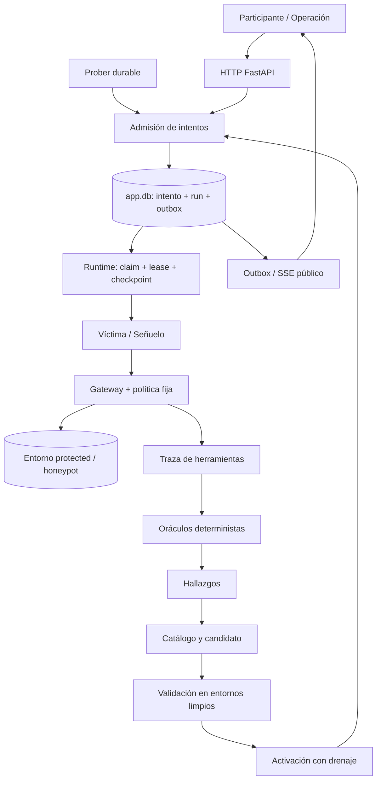

# Arquitectura implementada

Referencia del código publicado al 24 de octubre de 2026. El [índice por dominio](./dominio/README.md) enlaza servicios, contratos, pruebas y limitaciones; [continuidad](./continuidad.md) propone el orden de trabajo siguiente.

## Composición y ejecución

El despliegue es un monolito modular FastAPI/SQLAlchemy con workers asíncronos y SQLite o Postgres (el contenedor usa Postgres; ver [infraestructura](./dominio/infraestructura.md#base-de-datos)), más un frontend React/TypeScript servido por Vite en desarrollo o nginx en contenedor. Las dependencias están fijadas en `backend/uv.lock` y `frontend/pnpm-lock.yaml`.

| Entrada | Qué conecta |
| --- | --- |
| [main.py](../backend/src/agent_zero/main.py) | Configuración, creación de esquema, flota, LLM, núcleo, routers y ciclo de vida. |
| [fleet_builder.py](../backend/src/agent_zero/fleet/fleet_builder.py) | Registry, identidad, memoria, Armor, gateway, runtime y telemetría. |
| [arena/core.py](../backend/src/agent_zero/arena/core.py) | Entornos, herramientas contextuales, oráculos, hallazgos, validación, campañas, evaluación y rondas. |
| [App.tsx](../frontend/src/app/App.tsx) | Rutas de participante, arena y operación. |
| [compose.yaml](../infra/compose.yaml) | Backend, frontend/proxy y volumen persistente. |

Los handlers de arena se registran durante la inicialización. `ensure_agents()` publica/aprueba sus manifiestos al primer uso; publicar un manifiesto no instala código Python. La flota original conserva `support_conversation` 1.0.0; el núcleo utiliza manifiestos 2.2.0 y el handler `arena_attempt`.

El diagrama describe servicios y persistencia. El log de eventos no es un broker externo que ejecute automáticamente un consumidor por evento: `RunWorker`, `AttemptWorker` y `DefenseScheduler` consultan estado durable y coordinan las transiciones.

## Almacenamiento y transacciones

| Almacén | Contenido y límite |
| --- | --- |
| `app.db` | Registry/revocaciones/runtime, sesiones, intentos, hallazgos, políticas, campañas, evaluaciones, eventos/outbox y archivos de ronda. También memoria del recorrido de flota. |
| `protected.db` | Pedidos sintéticos, reembolsos, operaciones idempotentes, fixtures controlados y memoria de la arena protegida. |
| `honeypot.db` | Tablas del escenario y memoria independientes, con canarios señuelo. |
| Bases temporales | Copia inicial limpia por caso de validación/evaluación; no comparten los efectos del laboratorio persistente. |
| `llm/calls.jsonl` | Ledger de origen, uso, coste estimado, scopes, latencia y errores. |
| `audit/audit.jsonl` y auxiliares | Cadena HMAC, ancla, journal de recuperación y lock de archivo. |

Los modelos de aplicación usan `AppBase`; el escenario tiene `StoreBase`, más la tabla de memoria en cada entorno. `create_all` crea tablas; no existe una cadena de migraciones que adapte columnas antiguas.

La admisión serializa con `BEGIN IMMEDIATE` y guarda intento, run y eventos de transición juntos. La versión activa y sus eventos se actualizan en transacción. En el escenario, el guard del gateway comparte la transacción entre comprobar política y ejecutar el efecto. Los efectos guardan un `operation_id` y fingerprint para recuperarse sin duplicarlos.

La base y los JSONL no forman una transacción distribuida. Outbox, IDs durables, resultados de operación y journal firmado cubren ventanas de recuperación concretas; no deben sustituirse por un lock de proceso. Los leases y su fencing impiden que un worker vencido sobrescriba un checkpoint recuperado.

## Límites de confianza

| Frontera | Decisión del servidor |
| --- | --- |
| Participante → intento | Token firmado, consentimiento, tamaño, frecuencia, cupo y propietario. |
| Modelo → herramienta | Manifiesto, identidad, scopes, clasificación, región, esquema y controles de negocio por versión. |
| Fuente/memoria → modelo | Contenido no confiable con procedencia; no concede permisos. |
| Hallazgo → política | Controles acumulativos de catálogo, hash y validación; el modelo sólo redacta asesoría. |
| Arena → operación | Proyecciones públicas explícitas frente a `X-Operator-Secret`. |
| Sesión desviada → datos | Ruta persistida hacia el entorno señuelo; memoria por sesión y entorno. |

Las omisiones vulnerables de la política base son titularidad, límite comercial y claves de memoria. No eliminan los controles de identidad, clasificación o separación de archivos. Los participantes tienen clientes sintéticos únicos; las sesiones internas del Prober pueden reutilizar clientes semilla y comparten el estado protegido de la ronda.

## IA y decisiones deterministas

`LlmGateway` entrega cinco roles con contexto y registro de llamadas: víctima, señuelo, Prober, analizador y generador de explicaciones de parches. Modos y límites en [LLM](./dominio/llm.md).

Los oráculos determinan la violación a partir de herramientas, estado y respuesta. Los hallazgos y controles se derivan por código. `AnalyzerHandler` añade una interpretación en un run separado. `PatchExplainer` se espera dentro del run de validación antes de las pruebas: su salida no autoriza ni modifica el candidato, pero su latencia forma parte de ese run.

Cada intento conserva ruta y versión desde la admisión. La validación primero comprueba el contrafactual de la traza; después ejecuta original, dos variantes y cinco tareas legítimas, con concurrencia acotada. La activación espera el drenaje y un padre vigente. La repetición de operación crea una sesión protegida nueva y conserva el fixture controlado si lo había.

## API y fuentes de contrato

La API real está en los routers y el OpenAPI de `/docs`; la tabla completa de producto está en [núcleo](./nucleo.md#contratos-http). La clasificación se obtiene de `GET /api/arena/state`; no existe una ruta separada `/api/leaderboard`. Tampoco hay endpoints públicos para redactar o aprobar manualmente una política de negocio.

El operador puede inspeccionar, repetir, revertir, controlar entradas, revelar, lanzar/detener campañas/evaluaciones y resetear una ronda drenada. Los archivos de ronda se listan/descargan por API; la UI actualmente muestra el ID devuelto por el reset y exporta evidencia de intentos/evaluaciones.

## Recuperación, límites y pruebas

El arranque recupera resets marcados `resetting` y entregas pendientes. El reset conserva un snapshot verificable y restaura el laboratorio; no implementa restauración arbitraria desde un snapshot. El cierre normal detiene workers y dispone motores. El cleanup de errores de inicialización anteriores al `yield` sigue siendo una mejora pendiente.

Hay garantías comprobadas con varios workers/conexiones y auditoría multiproceso; esto no convierte el despliegue en una plataforma distribuida. Cuotas LLM y rate limiting genérico aún son locales al proceso. Runtime tiene dependencias explícitas de los guards de ronda de arena, y políticas/gateway conectan dominios: el grafo actual no es estrictamente unidireccional.

La [matriz de pruebas](./pruebas/por-dominio.md) enlaza cada garantía. La [evidencia guardada](./pruebas/evidencias.md) distingue 270 ejecuciones DEMO del ciclo LIVE de 93 llamadas y conserva errores, pendientes y procedencia.
