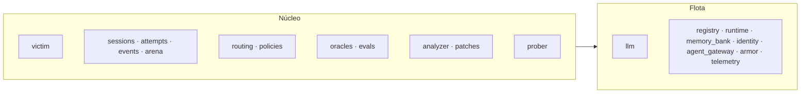

# Dominio de Agent Zero

Estado: diseño del 24 de octubre de 2026 con el ciclo P0 implementado sobre la flota. La guía de [núcleo implementado](../nucleo.md) es la referencia del estado actual, API y límites; los documentos de diseño conservan también ampliaciones pendientes.

Esta carpeta reúne qué es el producto, cómo se organizan sus agentes, cómo se toma cada decisión y qué hace cada dominio. Complementa a [arquitectura](../arquitectura.md), [evaluación](../evaluacion.md) y [demo](../demo.md), que siguen siendo la referencia del escenario y del protocolo de medición.

## Documentos transversales

| Documento | Responde a |
| --- | --- |
| [Visión](./vision.md) | De qué va el proyecto y por qué es un *purple team* autónomo y no solo un red team. |
| [Agentes](./agentes.md) | Qué agentes hay, por categoría y departamento, con su rol de modelo y sus especialidades. |
| [Flujo de decisión](./flujo-de-decision.md) | La máquina de estados por eventos, quién decide cada cosa y por qué no hay un agente supervisor. |
| [Rendimiento](./rendimiento.md) | Cómo hacerlo rápido, preciso y eficiente, con las métricas que lo demuestran. |
| [Casos de uso](./casos-de-uso.md) | Actores, objetivos adversarios, los 16 casos de uso, flujos de usuario y orden de construcción. |

## Dominios del núcleo

Cada dominio vive en `backend/src/agent_zero/<dominio>/` con la estructura de [desarrollo](../desarrollo.md): `models.py`, `schemas.py`, `repository.py`, servicios separados por operación y `router.py`. El responsable sale de [equipo](../equipo.md).

| Dominio | Documento | Categoría | Responsable | Estado hoy |
| --- | --- | --- | --- | --- |
| `victim` | [victim](./victim.md) | Objetivo | Carlos | Bucle nativo de herramientas, efectos idempotentes, canarios y entornos aislados; conserva el recorrido de la flota. |
| `sessions` | [sessions](./sessions.md) | Arena | Francisco | Consentimiento, tokens firmados, tres clientes sin repetir y aislamiento por propietario. |
| `attempts` | [attempts](./attempts.md) | Arena | Francisco | API, cupos, idempotencia, runs y checkpoints durables. |
| `routing` | [routing](./routing.md) | Control | Carlos | Desvío permanente por violación, Armor o negaciones repetidas. |
| `policies` | [policies](./policies.md) | Control | Carlos | Catálogo, versiones persistidas, activación atómica con drenaje y reversión. |
| `oracles` | [oracles](./oracles.md) | Juez | Fernando | Tres verificadores deterministas sobre traza y efectos persistidos. |
| `analyzer` | [Estado actual](../nucleo.md) | Defensa | Fernando | Hallazgos consolidados y persistidos; enriquecimiento LLM pendiente. |
| `patches` | [Estado actual](../nucleo.md) | Defensa | Fernando | Validación contrafactual y ocho casos aislados por candidato. |
| `prober` | [Estado actual](../nucleo.md) | Ofensiva | Fernando | Campañas con presupuesto y plantillas de tres familias. |
| `events` | [Estado actual](../nucleo.md) | Arena | Francisco | Persistencia, proyección pública y SSE con reanudación. |
| `arena` | [Estado actual](../nucleo.md) | Arena | Francisco | Chat, clasificación y panel autorizado; reinicio archivado pendiente. |
| `evals` | [Evaluación](../evaluacion.md) | Juez | Fernando | Suite amplia e informe pendientes. |

## Relación con la flota

El núcleo importa la capa de IA (`llm`) y la flota (`registry`, `runtime`, `memory_bank`, `identity`, `agent_gateway`, `armor`, `telemetry`); nunca al revés. La flota sabe ejecutar agentes de forma segura y trazable. El núcleo decide qué agentes hay, qué reglas existen y cómo se aprende de cada ataque. La guía para probar la flota está en [prueba de la flota](../prueba-flota.md) y sus requisitos en [trazabilidad](../trazabilidad.md).

## Principios

1. **El LLM propone y el código decide.** Ninguna decisión de seguridad (violación, ruta, activación, permiso de herramienta) depende de la opinión de un modelo.
2. **Coreografía por eventos, sin supervisor.** Cada evento dispara un trabajador; no hay un agente que coordine a los demás y al que se pueda convencer.
3. **Evidencia antes que relato.** Un hallazgo se sostiene en eventos de la traza y en cambios de estado, no en lo que respondió el agente.
4. **Utilidad protegida.** Un parche que rompe tareas legítimas se rechaza aunque detenga el ataque.
5. **Aislamiento por entorno.** Protegido, señuelo y validación usan datos separados; la ruta la decide el servidor.

## Glosario

| Término | Significado |
| --- | --- |
| Intento | Un mensaje o secuencia de hasta cuatro mensajes ejecutada contra la víctima o el señuelo. |
| Objetivo | Una regla del escenario que el atacante intenta romper (`OBJ-ORDER`, `OBJ-REFUND`, `OBJ-MEMORY`). |
| Oráculo | Comprobación determinista que decide si un intento violó un objetivo. |
| Hallazgo | Una vulnerabilidad reproducible que agrupa varios intentos con la misma causa. |
| Control | Un validador del catálogo cerrado que el gateway ejecuta antes de una herramienta. |
| Política | Una versión numerada del conjunto de controles activos. |
| Omisión intencional | Un control ausente en la versión base para que exista algo que descubrir. |
| Canario | Un marcador único en los datos protegidos que prueba una filtración si aparece en una salida. |
| Tiempo hasta el parche | Segundos desde la primera violación confirmada hasta la política activa que la bloquea. |
