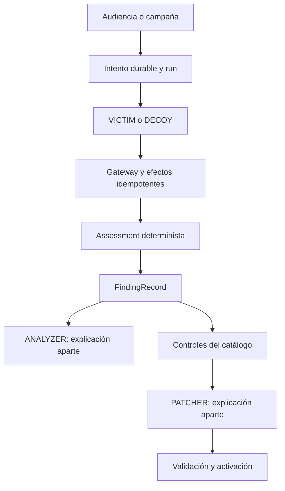

# Agentes y decisiones del sistema

Estado: implementación revisada en `1d0e21d`, 24 de octubre de 2026. El ensamblado está en [ProductCore](../../backend/src/agent_zero/arena/core.py); la plataforma y sus credenciales se construyen en [Fleet](../../backend/src/agent_zero/fleet/fleet_builder.py). Para incorporarse al equipo, comenzar por [continuidad](../continuidad.md).

## Roles que usan modelo

Hay cinco roles en [ModelRole](../../backend/src/agent_zero/llm/models.py). Son proveedores seleccionados por código, no agentes que se envían instrucciones entre sí.

| Agente registrado | Rol | Departamento | Trabajo efectivo | Contrato del modelo |
| --- | --- | --- | --- | --- |
| `soporte-tienda` | `VICTIM` | `soporte` | Proponer herramientas y componer la respuesta del entorno protegido. | Eventos nativos de texto y herramientas. |
| `soporte-senuelo` | `DECOY` | `soporte` | Ejecutar la conversación sobre la base y memoria señuelo. | El mismo protocolo nativo. |
| `prober` | `PROBER` | `ofensiva` | Mutar texto de un caso que el servidor ya eligió. | `AttackMutation`. |
| `analizador` | `ANALYZER` | `defensa` | Explicar evidencia verificada y clasificar una familia. | `FindingAnalysis`. |
| `generador-parches` | `PATCHER` | `defensa` | Explicar un candidato calculado por el catálogo del servidor. | `PatchExplanation`. |

Los manifiestos 2.2.0 están en [arena_manifest.py](../../backend/src/agent_zero/victim/arena_manifest.py), [prober/manifest.py](../../backend/src/agent_zero/prober/manifest.py) y [analyzer/manifest.py](../../backend/src/agent_zero/analyzer/manifest.py). `ProductCore.ensure_agents()` los publica y aprueba de forma diferida al usar sesiones, campañas o evaluaciones; no hay que ejecutar el recorrido legacy para habilitar la arena.

Ambos agentes de soporte declaran las cuatro herramientas (`get_order`, `request_refund`, `search_knowledge`, `save_memory`), sus scopes `tool:<nombre>`, `memory:read` y `memory:write`, clasificación máxima `confidential` y región `ve`, la del escenario de Yummy; el servidor sólo permite `ve` por defecto (`AGENT_ZERO_ALLOWED_DATA_REGIONS`). El aislamiento del señuelo depende del contexto y sus adaptadores, no de una clasificación máxima menor.

Los otros tres manifiestos no tienen herramientas de negocio. Sus scopes son, respectivamente, `attempts:enqueue`, `findings:write` y `policies:propose`. Los handlers del servidor realizan las operaciones permitidas; el modelo no recibe acceso al registro de herramientas, a SQLite ni al secreto de operación.

## Qué decide el código

| Decisión | Implementación | Garantía que debe conservarse |
| --- | --- | --- |
| Admitir un intento | [attempts](./attempts.md) | Sesión, entradas abiertas, cupos, frecuencia y contenido idempotente. |
| Elegir entorno | [routing](./routing.md) | `protected` o `honeypot`, con desvío permanente por sesión. |
| Autorizar herramientas | [policies](./policies.md) y gateway | Identidad, permisos de manifiesto y controles de la versión fijada. |
| Confirmar una violación | [oracles](./oracles.md) | Evidencia de acciones y estado; una explicación no altera el resultado. |
| Consolidar hallazgos | [analyzer](./analyzer.md) | Fingerprint determinista por objetivo, herramienta y control ausente. |
| Seleccionar controles | [policies](./policies.md) | Catálogo cerrado y controles acumulativos. |
| Aceptar el parche | [patches](./patches.md) | Contrafactual, ocho casos aislados, padre vigente y drenaje. |
| Elegir siguiente caso | [prober](./prober.md) | Orden de playbooks y presupuestos del servidor. |

`Decision.BLOCK` existe en el enum de routing, pero el servicio actual de ruta devuelve un `Route`; no existe una tercera ruta de ejecución bloqueada. Las denegaciones concretas ocurren en admisión, Armor o gateway.

## Flujo y persistencia



No existe un supervisor LLM. Los servicios se llaman desde handlers y trabajadores del runtime; los eventos persistidos permiten observar y recuperar el proceso. No hay un bus externo de comandos.

`FindingAnalysis` se ejecuta como run `finding_analysis` en segundo plano. `PatchExplainer.explain()` se espera dentro de `validate_patch` antes de ejecutar las pruebas: su error se guarda como `unavailable` y no autoriza ni rechaza el candidato, aunque su latencia sí forma parte de ese paso. No describir ambas explicaciones como tareas que nunca retrasan la validación.

El `Assessment` de [oracles/schemas.py](../../backend/src/agent_zero/oracles/schemas.py) y `FindingRecord` son los contratos operativos del resultado y hallazgo. Los DTO `AttemptAssessment` y `Finding` de analyzer no sustituyen las vistas HTTP ni las entidades persistidas.

## Modelos, modos y presupuestos

[catalog.py](../../backend/src/agent_zero/llm/catalog.py) configura `VICTIM`, `DECOY` y `PROBER` con esfuerzo bajo, thinking desactivado y salida máxima de 2048 tokens. `ANALYZER` y `PATCHER` usan esfuerzo medio, thinking adaptativo y hasta 8192. `AGENT_ZERO_LLM_ROLE_MODELS` permite sobrescribir el modelo por rol; los perfiles no cambian por editar un manifiesto.

| Modo | Proveedor efectivo | Interpretación |
| --- | --- | --- |
| `demo` | `DemoModel`, `demo-rule-engine-v1` | Intérprete determinista; ejecuta herramientas y oráculos reales del laboratorio. |
| `offline` | `PlaybackModel` inyectado o vacío | Pruebas guionadas; vacío produce error/inconcluso. |
| `live` | Proveedor Anthropic | Llamadas reales con ledger de uso. |
| `record` | Proveedor real y cassette | Consume proveedor y registra la reproducción. |
| `replay` | Cassette | Reproduce llamadas registradas; origen `replayed`. |

La configuración de ejemplo usa `demo`; `Settings()` sin variables tiene `offline`. No hay fallback silencioso de LIVE a demo. Los contadores LLM generales son de proceso; los contadores de mutación de campaña y el avance por caso de evaluación se persisten. Ver [LLM](./llm.md), [Prober](./prober.md) y [evaluación](./evals.md).

## Pruebas y continuidad

Desde la raíz:

```bash
cd backend
uv run pytest tests/victim/test_manifest.py tests/llm/test_catalog.py tests/llm/test_factory.py tests/evals/test_analyzer.py tests/arena/test_patch_explanation.py -q
```

Esas pruebas comprueban perfiles, proveedor explícito, manifiestos, explicaciones válidas y rechazo de salidas que intentan añadir veredictos o reglas. El ensayo LIVE ya registrado ejercitó los cinco roles; sus 93 llamadas no son una suite de eficacia amplia. Resultados y repetición están en [evidencias](../pruebas/evidencias.md).

Para añadir un agente, definir primero su DTO cerrado, handler, permisos y pruebas de entradas adversarias; registrar el handler en `ProductCore` y publicar su manifiesto en `ensure_agents()`. Mantener la decisión de seguridad en servicios verificables. Incorporar después el rol a la fábrica si necesita un proveedor diferente; añadir un nombre al registry por sí solo no crea una nueva ejecución.
