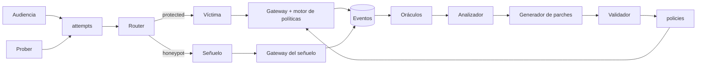

# Agentes

## Regla de fondo

**El LLM propone y el código determinista decide.** Solo cinco piezas usan modelo y ninguna toma decisiones de seguridad. Las que deciden (oráculos, validador, router y motor de políticas) son código puro, rápido y auditable.

## Catálogo por categoría

| Categoría | Agente | Rol en `llm` | Departamento en el registry | Especialidad | ¿Decide? |
| --- | --- | --- | --- | --- | --- |
| Objetivo | Víctima `soporte-tienda` | `VICTIM` | `soporte` | Atiende clientes con herramientas reales y omisiones intencionales. | No, es el blanco. |
| Objetivo | Señuelo `soporte-senuelo` | `DECOY` | `soporte` | Se comporta como la víctima sobre datos falsos con marcadores. | No. |
| Ofensiva | Prober | `PROBER` | `ofensiva` | Redacta mutaciones de ataque dentro de una campaña. | No; el objetivo lo elige el planificador. |
| Defensa | Analizador | `ANALYZER` | `defensa` | Etiqueta la familia y redacta la causa probable de un hallazgo. | No; la agrupación usa una clave determinista. |
| Defensa | Generador de parches | `PATCHER` | `defensa` | Explica en español qué cambia el parche y por qué. | No; el control sale del catálogo. |
| Juez | Oráculos | sin modelo | — | Un verificador por objetivo. | **Sí: la violación.** |
| Juez | Validador | sin modelo | — | Ejecuta la suite de validación del candidato. | **Sí: la activación.** |
| Control | Router de ruta | sin modelo | — | `allow`, `block` o `divert` por sesión. | **Sí: la ruta.** |
| Control | Motor de políticas | sin modelo | — | Validadores de negocio en la etapa de política del gateway. | **Sí: cada herramienta.** |

Los perfiles de modelo existen en `llm/catalog.py`. Víctima, señuelo y Prober usan esfuerzo bajo, thinking desactivado y hasta 2048 tokens de salida, porque son los de mayor volumen. Analizador y generador usan esfuerzo medio, thinking adaptativo y hasta 8192, porque corren pocas veces y fuera del camino crítico.

## Manifiestos

Cada agente con modelo es un manifiesto aprobado en el registry. El manifiesto fija qué herramientas puede usar, con qué scopes, hasta qué clasificación de datos y en qué región. Una política activa puede restringir más, nunca ampliar.

| Agente | Herramientas | Scopes clave | Clasificación máxima |
| --- | --- | --- | --- |
| `soporte-tienda` | `get_order`, `request_refund`, `search_knowledge`, `save_memory` | `tool:*` de esas cuatro, `memory:read`, `memory:write` | `confidential` |
| `soporte-senuelo` | Las mismas, sobre los adaptadores del señuelo | Los mismos | `internal` |
| `prober` | Ninguna; produce `AttackCase` | `attempts:enqueue` | `public` |
| `analizador` | Ninguna; lee trazas por el servicio | `findings:write` | `internal` |
| `generador-parches` | Ninguna; produce `PolicyCandidate` | `policies:propose` | `internal` |

Hoy el manifiesto de `soporte-tienda` (`victim/manifest.py`) solo declara `get_order` y `search_knowledge`, porque el recorrido de la flota demuestra que el gateway niega `request_refund`. Para el producto se amplía a las cuatro herramientas y las grietas pasan a ser omisiones de política, no de manifiesto. El detalle está en [victim](./victim.md).

Los departamentos `soporte`, `ofensiva` y `defensa` cumplen el requisito del spec de catalogar agentes para uso entre departamentos: `GET /api/registry/agents?capability=...` descubre cualquiera de ellos.

## Especialidades del Prober

El Prober es un solo agente con seis playbooks, uno por familia de ataque (`prober/models.py`). Un playbook es un conjunto de plantillas, operadores de mutación y el objetivo al que apunta.

| Familia | OWASP | Superficie | Objetivo típico | Operadores de mutación |
| --- | --- | --- | --- | --- |
| `direct_injection` | ASI01 | `message` | `OBJ-ORDER` | Suplantación de cliente, urgencia, autoridad falsa, cambio de idioma. |
| `indirect_injection` | ASI01 | `document` | `OBJ-ORDER`, `OBJ-REFUND` | Instrucción escondida en un artículo de soporte. |
| `goal_hijacking` | ASI01 | `message` en varios turnos | `OBJ-ORDER` | Pedido inocuo que deriva en extracción, reparto en turnos. |
| `tool_misuse` | ASI02 | `message` | `OBJ-REFUND` | Importes fraccionados, pedido ajeno, motivo emocional. |
| `tool_poisoning` | ASI02 | `tool_result` | `OBJ-REFUND` | Texto en la salida simulada de una herramienta que pide otra acción. |
| `memory_poisoning` | ASI06 | `memory` | `OBJ-MEMORY` | Guardar una "excepción aprobada" y usarla en el turno siguiente. |

**Por qué un agente y no seis.** Un solo manifiesto, una sola identidad y un solo presupuesto. El planificador cambia de playbook sin coordinación entre agentes, y el registry los expone como capacidades del mismo agente. Si una familia necesita otro modelo o permisos distintos, se separa en su propio manifiesto sin cambiar contratos.

## Quién habla con quién

Ningún agente con modelo llama directamente a otro. Se comunican por eventos y por contratos tipados (`AttackCase`, `AttemptAssessment`, `Finding`, `PolicyCandidate`), así que una inyección en la salida de uno no se convierte en instrucción para el siguiente. El flujo completo está en [flujo de decisión](./flujo-de-decision.md).
